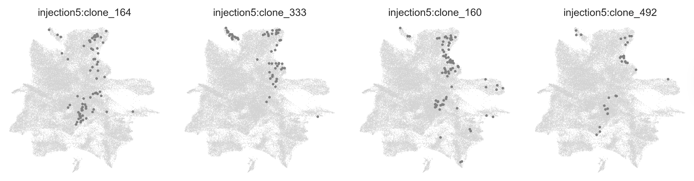
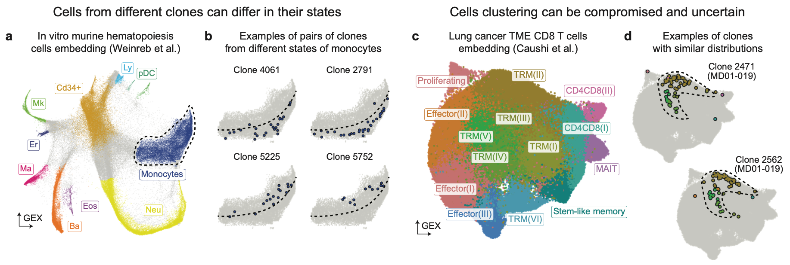
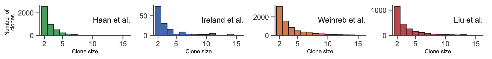

Biological intuitions
=====================

This page explains the biological ideas clone2vec is built on: what a clone tells you, why clones differ, why
comparing them is hard, and what a clonal embedding means. For how the method handles these problems, see
:doc:`computational_intuitions`; for how to run the analysis, see :doc:`tutorial`.

A clone is a record of shared history
-------------------------------------

A **clone** is the set of cells descended from one ancestor cell. Lineage tracing marks that ancestor with a heritable
label (a **barcode**), so that its descendants can be recognized later. The label can be a transgenic or viral
barcode, a set of CRISPR edits, a somatic mitochondrial mutation, or a T or B cell receptor sequence, which is a
natural barcode created when the lymphocyte rearranges its receptor genes.

Combined with single-cell sequencing, every barcoded cell carries two kinds of information: its current **state**
(gene expression) and its **history** (which other cells it is related to). Sister cells started from the same
ancestor, so differences between clones reveal what shaped their fates. A clonal dataset is in effect thousands of
small experiments that the tissue ran on its own.

What makes clones differ
------------------------

Two forces shape how a clone spreads across cell states, and clonal data is one of the few ways to tell them apart.

* **Ancestry (cell-intrinsic priming).** Some progenitors carry a bias that their descendants keep. For example,
  hematopoietic stem cells from the same clone keep a similar lineage output even when transplanted into different
  recipients: the clone's history wins over the environment.
* **Environment (position and signals).** In other systems, where a progenitor sits decides what it makes. In the
  hair follicle, a stem cell's position in its niche predicts its fate better than anything else. In the early neural
  tube, clones are confined to positional domains set by patterning signals.
* **Divergence within a clone.** Sister cells can also split apart. A single naive CD8 T cell can give rise to both
  short-lived effectors and long-lived memory cells, depending on what each daughter encounters.

Clonal variation is therefore not noise to be averaged away. It reflects how progenitors share out their potential
across space and time, and how tissues stay robust when local conditions change. clone2vec is a way to make this
variation visible and measurable across thousands of clones at once.

A clone is a distribution over cell states
------------------------------------------

A clone is not one cell type and not one point in expression space. It is a **cloud of cells**, often spread over
several regions of the expression landscape: a progenitor state, one or more differentiating branches, sometimes a
few rare states. To compare two clones is to compare two such distributions.

Looking at many clones, the same distribution shapes keep coming back: different clones cover the same combinations
of regions. These recurrent shapes are the **clonal behaviours** that clone2vec looks for.

Why cell types are not enough
-----------------------------

The usual shortcut is to describe each clone by its cell type composition ("40% neurons, 60% progenitors"). This loses
information in three ways:

* **Labels can be too coarse.** In in vitro hematopoiesis, two monocyte lineages with different histories occupy
  separate monocyte states, yet both end up labelled "monocyte". Their clones look identical by composition.
* **Boundaries can be arbitrary.** Many cell populations form continuous gradients rather than discrete groups. For
  example, tumour-infiltrating CD8 T cells move gradually between resident-memory, effector and transitional states.
  Any clustering draws borders through these gradients, and clones that straddle a border look artificially
  different.
* **Composition ignores where in a cell type the cells sit.** Two clones that are both "100% monocyte" can occupy
  different parts of the monocyte state, and that difference can be the biologically interesting one.

clone2vec avoids these problems by never using labels to compare clones. It compares clones directly by where
their cells sit in expression space.

Most clones are seen through a keyhole
--------------------------------------

Lineage tracing data is sparse. Only a fraction of each clone is captured, so most clones are represented by a handful
of cells, while a few are represented by hundreds. A clone sampled with three cells may show only one of the fates it
actually produced. On its own, its distribution can't be estimated reliably.

This has a biological cost. Analyses that only trust large clones throw most clones away, and the clones that remain
are a biased sample: the most proliferative lineages, or the ones that happened to be captured well. clone2vec is
designed to keep small clones in the analysis by learning from all clones together, letting each one count in
proportion to how much it was observed. :doc:`computational_intuitions` shows how this works, and where it reaches its
limits.

What the clonal embedding means
-------------------------------

clone2vec turns every clone into a vector, and the geometry of these vectors has a direct biological reading.

* **Close clones behave alike.** Two clones are close when their cells occupy the same regions of expression space
  in similar proportions. This holds at the level of detailed states, not only cell types.
* **Mixed clones sit between pure ones.** The embedding supports vector arithmetic. If some clones make only cell
  type A and others only B, a clone that makes both equally sits halfway between them. Graded fate biases therefore
  appear as continuous directions, not as forced categories.
* **Clusters are recurrent behaviours; gradients are graded biases.** Clustering the embedding groups clones with
  shared behaviour. When behaviours vary continuously, archetypes (extreme behaviours that others are mixtures of)
  describe the space better than clusters.
* **Clonal clusters reorganize the cells.** Mapping clonal clusters back onto the cells splits the expression
  landscape in ways the expression data alone does not show. The same cell state can be reached by clones with
  different histories, and one clonal behaviour can connect a progenitor population to several distinct branches.

What the embedding captures depends on when the barcode was set
---------------------------------------------------------------

A barcode records history from the moment it was introduced. The same method therefore answers different biological
questions depending on the experiment:

.. list-table::
   :header-rows: 1
   :widths: 30 70

   * - Barcode introduced
     - Clonal variation reflects
   * - Early in development, before cells commit
     - Differences in progenitor competence and fate bias, often linked to position or timing.
   * - At lineage commitment (T and B cell receptors)
     - Plasticity and restrictions *within* one committed cell type: distinct origins of similar-looking cells,
       or different histories of antigen exposure.
   * - In a disease model (e.g. a tumour)
     - Plasticity between malignant states and the routes cells take between them.

Examples of what this reveals
-----------------------------

For worked examples on real data, including embryonic brain development, small-cell lung cancer, the origins of
regulatory T cells and recurring lineages of tumour-infiltrating CD8 T cells, see the clone2vec preprint:

   Isaev S., Erickson A. G., Adameyko I., Kharchenko P. V. *Clonal embeddings allow exploratory analysis of
   lineage-resolved single-cell data.* bioRxiv (2026). https://doi.org/10.64898/2026.04.30.720820

From clonal behaviour to genes
------------------------------

Once clones are organized by behaviour, the next question is which genes go with it. Typical questions:

* **Which progenitor genes predict a clone's later output?** Compare progenitor cells between clonal clusters
  that differ in their downstream fates.
* **Do cells of the same type carry a memory of their lineage?** Compare cells of one mature type between
  clonal clusters. Differences there are imprinted by history, not by cell type.
* **Which genes explain the clonal variation as a whole?** Test genes against the entire embedding instead of
  against two chosen groups. This can surface axes of variation you didn't think to test.

To avoid circular conclusions, the population being tested can be hidden while the embedding is built, so that the
clonal behaviour is defined only by the other cells. The :doc:`Gene_expression_associations` example shows all three
analyses.

What clone2vec is and is not for
--------------------------------

clone2vec treats clones as indivisible units and gives an **exploratory, annotation-free overview** of clonal
variation: which behaviours exist, how they relate, and what to test next. It does not reconstruct lineage trees.
When the goal is specifically to predict the fate of early progenitors, methods that also borrow information from
unlabelled cells (such as CoSpar) can be more sensitive. The approaches are complementary: clone2vec maps the
landscape of clonal behaviours, and targeted methods then zoom in on specific transitions.

Because it only needs clone labels and a way to find neighbouring cells, the same approach applies to other
modalities (e.g. chromatin accessibility) and to any source of clone labels. It also applies beyond clones, to any
groups of cells that can be compared by their distributions.

Next: :doc:`computational_intuitions` shows the same ideas on a toy system you can play with, :doc:`tutorial` shows
the analysis step by step, and the Examples section applies it to real datasets.