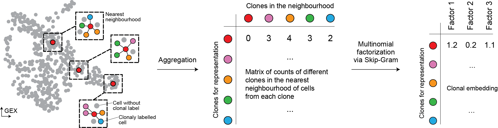

Computational intuitions
========================

Why is clone2vec built the way it is? This page answers that question with a toy system where the right answer is
known: **rings and crosses**. Below is an interactive walkthrough of the whole pipeline, running live in your browser
on simulated data (nothing is sent to a server), with a short list of things to try in it. The explanations behind
each observation follow after the walkthrough.

For the biological side of the same ideas, see :doc:`biological_intuitions`. For the code, see :doc:`tutorial`.

The toy system
--------------

* **Expression space** is a 2D disc: a stand-in for a UMAP of real cells, with 10,000 unbarcoded cells in the
  background.
* **Every clone** is a set of barcoded cells drawn from one of ten hidden **shapes**: a core, three rings of
  increasing radius, and six crosses rotated in 15° steps.
* **The task** is to place clones of the same shape together without ever being told the shapes.

The shapes are chosen to be hard in a realistic way. Rings differ by *where* their cells are. Crosses all pass
through the centre and differ only by angle, so clones of different crosses share the central cells, while two clones
of the same cross may not have a single cell in the same place. The crosses also form a continuum that wraps around:
75° is next to 0°, just as real differentiation paths share early states and diverge later.

Six ready-made examples, from *Toy* to *Extreme*, change the number and size of clones. Under *Edit dataset*, you
can also set the number of clones per shape, the clone-size distribution and the fraction of cells captured.

Things to try
-------------

1. **See the problem.** In Part 1, switch from *Very easy* to *Very hard*. Clones shrink from filled-in shapes to a
   few scattered cells, and most clones have only 2–3 cells. (Why this matters: :ref:`ci-direct`.)
2. **Compare clones directly.** In Part 2, compare the E-distance t-SNE for *Very easy* and *Very hard*. The shapes
   separate with large clones and blur together with small ones. (:ref:`ci-direct`)
3. **Follow one number.** In Part 3, step 1, load *Toy* and click a cell of the matrix. The left panel draws exactly
   the neighbour edges behind that number. With *Easy*, the matrix shows one block per shape.
   (:ref:`ci-neighbours`)
4. **Watch the small clones.** Load *Extreme*, where half the clones have only 2–4 cells. Compare the E-distance
   t-SNE in Part 2 with the clone2vec t-SNE in Part 3, step 3. With E-distance, the small clones scatter between the
   shapes; with clone2vec, most of them sit with their shape. (:ref:`ci-neighbours` and :ref:`ci-model`)
5. **Look inside the model.** In step 2, watch the GLM-PCA fit converge, then click a clone to compare its observed
   and reconstructed neighbour profile. (:ref:`ci-model`)

Interactive walkthrough
-----------------------

.. only:: html

   .. raw:: html

      <iframe id="c2v-walkthrough" src="_static/walkthrough/index.html" title="Interactive clone2vec walkthrough"
              style="display:block;width:100%;height:2400px;border:0;overflow:hidden" scrolling="no"></iframe>
      

.. only:: latex

   The interactive walkthrough is available in the online documentation at
   https://clone2vec.readthedocs.io/computational_intuitions.html.

Why it works this way
---------------------

.. _ci-direct:

Comparing clones directly needs dense sampling
~~~~~~~~~~~~~~~~~~~~~~~~~~~~~~~~~~~~~~~~~~~~~~

The most direct way to compare two clones is to compare their cell distributions, for example with the energy
distance: ``E(A,B) = 2·mean‖a−b‖ − mean‖a−a′‖ − mean‖b−b′‖``. It is zero when both clones come from the same
distribution.

This works when clones are large, because each clone then fills in its shape. With small clones, each distribution is
estimated from a few cells, so the distance mostly measures which cells happened to be sampled. Two small clones of
the same cross look far apart unless their few cells land near each other.

.. _ci-neighbours:

Describing a clone by its neighbours
~~~~~~~~~~~~~~~~~~~~~~~~~~~~~~~~~~~~

clone2vec does not compare clone shapes directly. Instead, it asks every barcoded cell which clones its *k* nearest
neighbours belong to, and adds these counts up per clone. The result is a clone × clone matrix: row *i* says how
often the cells of clone *i* sit next to cells of every clone.

This changes what "similar" means. Two clones of the same cross never need to share a position: it is enough that
both sit next to cells of *other* clones of that cross. A three-cell clone gives only three points for its shape, but
3 × *k* neighbour observations, all comparable with those of a large clone. The neighbourhood size *k* is the scale of
the comparison: a small *k* reads fine structure but gives noisy counts, a large *k* averages over wider regions and
blurs neighbouring shapes together.

.. _ci-totals:

Rows have very different totals
~~~~~~~~~~~~~~~~~~~~~~~~~~~~~~~

The rows of the neighbour-count matrix are not on the same scale: a clone with 300 cells collects 100 times more
neighbours than a clone with 3 cells. The usual single-cell recipe fixes this by scaling every row to the same total
and taking ``log1p`` before PCA.

That scaling hides how much evidence each row has. After normalization, a row built from 15 neighbours counts as
much as a row built from 1,500. A tiny clone's row is mostly zeros, and mostly-zero rows look alike regardless of
the shape they came from, so PCA would pull the tiny clones of every shape towards the same place. clone2vec avoids
this by not normalizing at all, as the next section explains.

.. _ci-model:

Modelling the counts instead of normalizing them
~~~~~~~~~~~~~~~~~~~~~~~~~~~~~~~~~~~~~~~~~~~~~~~~

clone2vec keeps the raw counts and fits a model of them. Each row is treated as a **multinomial sample**: the
clone's neighbours are split between clones with probabilities ``softmax(C·W + b)``. ``C`` holds one low-dimensional
vector per clone (the clonal embedding), ``W`` describes each neighbour clone, and ``b`` captures how common each clone
is overall. This is a multinomial GLM-PCA, and it is the same objective as the Skip-Gram model of word2vec: predict
the clones of a cell's neighbours from the cell's own clone.

Three consequences follow:

* **Each clone is weighted by its evidence.** A row with 1,500 neighbours contributes 1,500 observations to the
  likelihood, a row with 15 only 15. Small clones are kept, but they can't distort the embedding.
* **Zeros need no special treatment.** A missing neighbour is simply an observed count of zero; there is no
  pseudo-count to choose.
* **Overall abundance is factored out.** Because ``b`` absorbs how common each clone is, ``C`` describes how a clone's
  neighbourhood *deviates* from the average one. Distances in the embedding follow the pointwise mutual information
  between clones: whether two clones meet more or less often than chance would predict.

.. _ci-geometry:

Distances in the embedding compare neighbourhoods
~~~~~~~~~~~~~~~~~~~~~~~~~~~~~~~~~~~~~~~~~~~~~~~~~

Why can we use plain Euclidean distances between clonal vectors, as ``sc.pp.neighbors`` does by default? It follows
from the model itself. In GLM-PCA, the log-probability that a neighbour of clone *i* belongs to clone *j* is linear
in the clone's vector: ``C_i·W_j + b_j``, minus a per-clone normalizing constant. For two clones *i* and *i′*, the
difference between their predicted log neighbour profiles is therefore ``(C_i − C_i′)·W``, up to that constant.

* **Close vectors mean similar neighbourhoods.** If two clones have nearly the same vector, the model predicts nearly
  the same neighbourhood for both. The further apart their vectors, the more their log neighbour profiles differ.
* **The difference vector is interpretable.** ``C_i − C_i′`` says *in which way* the two neighbourhoods differ, which
  is what makes clonal axes and gene associations meaningful.
* **Mixtures are easy to read.** A clone that splits its cells equally between two behaviours ends up between the
  clones that show each behaviour alone.

Small clones are still placed less precisely than large ones. With few neighbour observations, their position is
uncertain, so they scatter more around the shape they belong to. This is the noise you see around each group in the
*Extreme* example. The walkthrough uses Euclidean distances throughout, just like the package.

What the toy does and doesn't show
----------------------------------

* **When clones are large, even direct comparison works.** With *Very easy*, E-distance and clone2vec give nearly
  the same picture. The difference grows as clones get smaller and their sizes more uneven, as in *Hard* and
  *Extreme*, which is the typical regime of real lineage tracing data.
* **No method recovers information that isn't there.** In *Very hard*, most clones have two or three cells, and all
  approaches lose part of the structure. Describing clones by their neighbours still keeps more of it than comparing
  their cells directly, but no model can make a two-cell clone informative.
* **The toy is two-dimensional.** Real expression spaces are high-dimensional and the kNN graph is built in PCA or
  a batch-corrected space, but the logic of every explanation above carries over unchanged.

From the toy to your data
-------------------------

Every knob in the walkthrough has a counterpart in the package:

.. list-table::
   :header-rows: 1
   :widths: 40 60

   * - Walkthrough
     - Package
   * - *k* in step 0
     - ``c2v.tl.clonal_nn(adata, clones, k=15)``
   * - Dropping tiny clones
     - ``c2v.pp.clones_adata(adata, min_size=...)``
   * - Number of GLM-PCA factors
     - ``c2v.tl.clone2vec(clones, z_dim=10)``
   * - The neighbour-count matrix
     - ``clones.obsp["gex_adjacency"]``
   * - The clonal embedding ``C``
     - ``clones.obsm["clone2vec"]``

See :doc:`tutorial` for the full workflow.