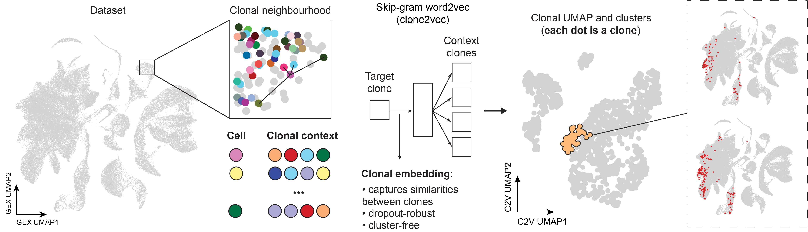

Usage basics
============

This page explains what clone2vec does, which objects it works with, and what the minimal analysis looks like.
After reading it you should know what each step computes and how to read the result. For full analyses on real
datasets, see the Examples section.

The idea in three sentences
---------------------------

clone2vec describes every clone by **which other clones its cells sit next to in gene expression space**. It builds a
clone × clone matrix of these neighbour counts and compresses it into a low-dimensional **clonal embedding**: one
vector per clone. Clones with similar vectors live in similar transcriptional neighbourhoods, so you can cluster,
visualize and test clones exactly like you would cells in a regular scRNA-Seq analysis.

Two things follow from this design:

* **No cell type annotation is needed.** The embedding is built from neighbourhoods, not from labels, so it also
  captures differences between clones *within* a cell type, and it doesn't depend on how you clustered your cells.
* **A clone is a distribution, not a point.** Two clones are similar when their cells are spread over the same
  regions of expression space, even if no two of their cells sit in exactly the same place.

What you need
-------------

A cell-level ``AnnData`` object (``adata`` below) with:

* **A low-dimensional representation** in ``adata.obsm``, e.g. ``"X_pca"``. This is the space in which neighbours are
  found, so it defines what "similar cells" means. If your data has batch effects, use a batch-corrected
  representation (e.g. ``"X_pca_harmony"``); otherwise clones will group by batch. If your integration gives a
  neighbour graph rather than an embedding, see :doc:`Graph_input`.
* **A column with clone labels** in ``adata.obs``, with one value (e.g. ``"NA"``) for cells without a barcode. Each
  label must identify one real clone: if the same barcode was reused across samples, wells or time points, combine
  the columns first (e.g. ``sample + ":" + barcode``).
* *Optional:* a cell type column. It is used only to describe clones (their fate composition), never to build the
  embedding.

Two objects: cells and clones
-----------------------------

clone2vec works with two ``AnnData`` objects side by side:

* ``adata``: **one row per cell**, your usual scRNA-Seq object.
* ``clones``: **one row per clone**, created by clone2vec. Everything clone-level is stored here:

.. list-table::
   :header-rows: 1
   :widths: 35 65

   * - Slot
     - Content
   * - ``clones.obs["n_cells"]``, ``clones.obs["n_fates"]``
     - Number of cells and number of cell types per clone.
   * - ``clones.X``, ``clones.layers["proportions"]``
     - Cell type proportions per clone (only if ``fill_obs`` was given). ``clones.var_names`` are the cell types.
   * - ``clones.layers["counts"]``
     - Cell type counts per clone.
   * - ``clones.obsp["gex_adjacency"]``
     - The clone × clone neighbour-count matrix (step 2).
   * - ``clones.obsm["clone2vec"]``
     - The clonal embedding (step 3).
   * - ``clones.uns["clone2vec"]``
     - Training details, including the loss history.

Results move between the two objects with ``c2v.pp.transfer_annotation`` (labels) and
``c2v.pp.transfer_expression`` (gene expression summarized per clone).

The minimal workflow
--------------------

.. code-block:: python

    import scanpy as sc
    import clone2vec as c2v

    # 1. One row per clone
    clones = c2v.pp.clones_adata(
        adata,
        obs_name="clone",      # column with clone labels
        min_size=2,            # drop clones with fewer cells
        na_value="NA",         # label of cells without a barcode
        fill_obs="cell_type",  # optional: compute fate composition
    )

    # 2. Clone × clone neighbour counts
    c2v.tl.clonal_nn(adata, clones, use_rep="X_pca", k=15)

    # 3. Clonal embedding
    c2v.tl.clone2vec(clones)
    c2v.pl.loss_history(clones)  # check that training converged

    # 4. Analyse clones like cells
    sc.pp.neighbors(clones, use_rep="clone2vec")
    sc.tl.umap(clones)
    sc.tl.leiden(clones, flavor="igraph", n_iterations=2)
    sc.pl.umap(clones, color=["leiden", *clones.var_names])

    # 5. Bring clonal clusters back to the cells
    c2v.pp.transfer_annotation(adata, clones, annotation_obs_clones="leiden")
    c2v.pl.group_kde(adata, groupby="c2v_leiden", basis="X_umap")

What each step does
-------------------

Step 1: one row per clone
~~~~~~~~~~~~~~~~~~~~~~~~~

``c2v.pp.clones_adata`` creates the ``clones`` object. ``min_size`` removes clones that are too small to describe:
a clone of one or two cells gives only a handful of neighbour observations. The removed clones are listed in
``clones.uns["filtered_clones"]``, and ``c2v.pl.clone_size(clones)`` shows the size distribution that remains.

Step 2: who neighbours whom
~~~~~~~~~~~~~~~~~~~~~~~~~~~

``c2v.tl.clonal_nn`` finds the ``k`` nearest neighbours of every barcoded cell in ``use_rep``, using only the cells of
the clones kept in step 1. For each clone it then counts how many of its cells' neighbours belong to each clone,
itself included. The result is the matrix ``clones.obsp["gex_adjacency"]``: row *i* is the **neighbourhood profile**
of clone *i*.

This profile replaces gene expression as the description of a clone. It is a natural choice because it is
directly comparable between clones of very different shapes: a clone spread over three cell types and a clone sitting
in one niche are both described by the same kind of vector. ``k`` sets the scale of a neighbourhood: a small ``k``
reads fine local structure but gives noisier counts, a large ``k`` averages over wider regions.

Step 3: the clonal embedding
~~~~~~~~~~~~~~~~~~~~~~~~~~~~

``c2v.tl.clone2vec`` compresses the neighbour-count matrix into ``z_dim`` dimensions (10 by default) and stores the
result in ``clones.obsm["clone2vec"]``. It trains a Skip-Gram model, the same objective as word2vec: predict the
clones of a cell's neighbours from the cell's own clone. Mathematically this is a multinomial GLM-PCA of the count
matrix: a low-rank model of how each clone's neighbours are split between clones.

Why not simply run PCA on the matrix? Its rows have very different totals, because a clone with 300 cells collects
100 times more neighbours than a clone with 3 cells. PCA needs the rows normalized first, and after normalization a
row built from a few neighbours counts as much as one built from hundreds, so small clones add noise. The
multinomial model works with the raw counts: it compares proportions, weights each clone by how much evidence it
has, and needs no pseudo-count for the many zeros. This is what makes the embedding robust in the sparse, uneven
regime of lineage tracing data.

Training is much faster on a GPU. If it takes too long on a CPU, ``c2v.tl.clone2vec_Poi(clones)`` fits a Poisson
GLM-PCA instead; it gives a comparable embedding in ``clones.obsm["clone2vec_Poi"]``.

Step 4: analyse clones like cells
~~~~~~~~~~~~~~~~~~~~~~~~~~~~~~~~~

From here on, ``clones`` behaves like any scRNA-Seq object, and standard ``scanpy`` functions work on it. Two things to
keep in mind when reading the result:

* **Distances and neighbours are meaningful; single axes are not.** As with PCA of genes, individual embedding
  dimensions have no fixed biological meaning. Use the embedding for kNN graphs, clustering, UMAP and trajectories.
* **Describe clusters with something you can interpret.** Plot the fate proportions on the clonal UMAP
  (``sc.pl.umap(clones, color=clones.var_names)``) or summarize them per cluster with ``sc.pl.dotplot``. Clonal clusters
  often differ by more than their composition, which is what step 5 and the later analyses show.

Step 5: back to the cells
~~~~~~~~~~~~~~~~~~~~~~~~~

``c2v.pp.transfer_annotation`` copies clone-level labels to every cell of the clone (as ``adata.obs["c2v_<column>"]``),
and in the other direction copies cell-level labels to clones (as ``clones.obs["gex_<column>"]``). With clonal
clusters on the cells, ``c2v.pl.group_kde`` and ``c2v.pl.group_scatter`` show where the cells of each clonal cluster
sit in expression space. In Jupyter, ``c2v.pl.clones2cells`` opens an interactive view of both embeddings side by
side: select clones on one, see their cells on the other.

Where to go next
----------------

.. list-table::
   :header-rows: 1
   :widths: 45 55

   * - Question
     - Example
   * - Full walkthrough of the steps above on a real dataset
     - :doc:`Clonal_embeddings`
   * - Faster embedding for large datasets
     - :doc:`Fast_clonal_embeddings`
   * - Which genes are associated with clonal behaviour?
     - :doc:`Gene_expression_associations`
   * - Is the clonal structure more than chance?
     - :doc:`Structure_test`
   * - The clonal embedding has no clear clusters (continuous behaviour)
     - :doc:`Archetypal_analysis`
   * - Your cells come with a neighbour graph (e.g. WNN, batch-balanced kNN) instead of an embedding
     - :doc:`Graph_input`
   * - Clones group by batch: diagnosing batch effects
     - :doc:`Batch_effect_propagation`
   * - Align clonal embeddings across datasets
     - :doc:`Integration`
   * - Clones defined by mtDNA mutations or other non-barcode sources
     - :doc:`mtDNA_mutations`
   * - The same method beyond clones: spatial clustering of genes
     - :doc:`Spatial_classification_mRNA`

For every function and parameter, see the :doc:`api`. For the intuition behind the method, see :doc:`basics`.